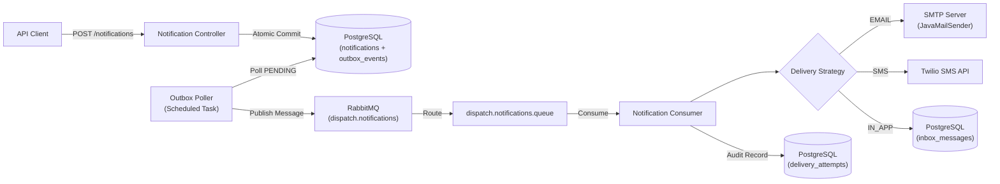

# Dispatch

[](https://openjdk.org/projects/jdk/21/)
[](https://spring.io/projects/spring-boot)
[](https://www.postgresql.org/)
[](https://www.rabbitmq.com/)
[](LICENSE)

**Dispatch** is a reliable, asynchronous backend notification platform built with **Spring Boot 3.3** and **Java 21**. It orchestrates multi-channel notifications (Email, SMS, In-App) via a transactional outbox pipeline backed by **PostgreSQL** and **RabbitMQ**, guaranteeing zero lost notifications and full delivery auditability.

---

## Architecture Overview

Dispatch uses the **Transactional Outbox Pattern** to prevent dual-write inconsistencies between database mutations and message publishing. When a notification request arrives, both the notification record and its corresponding outbox event are persisted atomically within the same database transaction before any message broker communication occurs.



---

## Core Features

* **Transactional Outbox Pattern**: Atomic database writes guarantee no message is lost, even during network failures or broker downtime.
* **Multi-Channel Dispatch**: Pluggable Strategy pattern supporting **Email** (SMTP / JavaMailSender), **SMS** (Twilio REST API), and **In-App** inbox persistence.
* **Asynchronous Queue Pipeline**: Offloads external delivery provider latency from API response times using durable RabbitMQ queues.
* **Stateless JWT Security**: HMAC-SHA256 authenticated API access with automatic refresh token rotation and BCrypt-hashed credentials.
* **Strict Idempotency**: Deduplicates repeated API submissions using caller-supplied idempotency keys.
* **Append-Only Delivery Audit**: Every dispatch attempt is recorded with provider responses, timestamps, and standardized error codes.
* **Production-Hardened Configuration**: Profile-driven architecture (`dev` vs. `prod`), startup secret strength validation (256-bit HMAC keys), and secured Actuator health monitoring.

---

## Tech Stack

| Component | Technology | Description |
|---|---|---|
| **Runtime** | Java 21 | Modern LTS language features and performance |
| **Framework** | Spring Boot 3.3.5 | Core dependency injection, MVC, and AMQP |
| **Persistence** | PostgreSQL 16 + Spring Data JPA | Relational persistence with JSONB metadata storage |
| **Database Migrations** | Flyway | Versioned database migrations (`V1` to `V6`) |
| **Message Broker** | RabbitMQ 3.13 | Message routing, durable queues, and Dead Letter Exchange (DLQ) |
| **Authentication** | JJWT (0.12.3) | Stateless JSON Web Tokens (Access + Refresh) |
| **External Providers** | JavaMailSender + Twilio SDK | Multi-channel communication adapters |
| **Documentation** | SpringDoc / OpenAPI 3 | Interactive Swagger UI with Bearer auth |
| **Testing** | JUnit 5, Mockito, MockMvc | Comprehensive unit and integration test coverage |

---

## Getting Started

### Prerequisites

* **Java 21** or later
* **Maven 3.9+**
* **Docker & Docker Compose**

### 1. Start Infrastructure

Launch PostgreSQL and RabbitMQ using the provided Docker Compose configuration:

```bash
docker compose up -d
```

Service mapping:
* **PostgreSQL**: `localhost:5433` (mapped from container `5432`)
* **RabbitMQ AMQP**: `localhost:5672`
* **RabbitMQ Management UI**: [http://localhost:15672](http://localhost:15672) (`guest` / `guest`)

### 2. Run the Application

```bash
mvn spring-boot:run
```

The application starts on `http://localhost:8080`. Flyway automatically executes database migrations on boot.

### 3. Verify Health & Interactive Docs

* **Swagger UI (Interactive API Docs)**: [http://localhost:8080/swagger-ui.html](http://localhost:8080/swagger-ui.html)
* **Application Health Check**: `curl http://localhost:8080/actuator/health`

---

## Configuration & Environment Variables

The application runs locally without any required setup using safe development defaults. For staging and production, create a `.env` file (see [.env.example](file:///.env.example)) and activate the production profile:

```bash
export SPRING_PROFILES_ACTIVE=prod
```

| Variable | Description | Local / Dev Default | Production |
|---|---|---|:---:|
| `PORT` | HTTP server port | `8080` | Optional |
| `SPRING_PROFILES_ACTIVE` | Active profile (`dev`, `prod`) | `dev` | **Recommended** |
| `DB_HOST` | PostgreSQL host | `localhost` | **Required** |
| `DB_PORT` | PostgreSQL port | `5433` | **Required** |
| `DB_NAME` | Database name | `dispatch_db` | **Required** |
| `DB_USERNAME` | Database username | `dispatch` | **Required** |
| `DB_PASSWORD` | Database password | `dispatch` | **Required** |
| `RABBITMQ_HOST` | RabbitMQ broker host | `localhost` | **Required** |
| `RABBITMQ_PORT` | RabbitMQ broker port | `5672` | **Required** |
| `RABBITMQ_USERNAME` | RabbitMQ user | `guest` | **Required** |
| `RABBITMQ_PASSWORD` | RabbitMQ password | `guest` | **Required** |
| `JWT_SECRET` | HMAC-SHA256 secret (minimum 256 bits) | Dev default (blocked in prod) | **Required** |
| `JWT_EXPIRATION_MS` | Access token TTL in milliseconds | `86400000` (24h) | Optional |
| `JWT_REFRESH_EXPIRATION_MS` | Refresh token TTL in milliseconds | `604800000` (7d) | Optional |
| `MAIL_HOST` | SMTP server host | `smtp.gmail.com` | **Required** |
| `MAIL_PORT` | SMTP server port | `587` | Optional |
| `MAIL_USERNAME` | SMTP account username | *(empty / simulated)* | **Required** |
| `MAIL_PASSWORD` | SMTP password / app password | *(empty / simulated)* | **Required** |
| `MAIL_FROM` | Sender email address | `noreply@dispatch.io` | **Required** |
| `TWILIO_ACCOUNT_SID` | Twilio Account SID | *(empty / simulated)* | Optional |
| `TWILIO_AUTH_TOKEN` | Twilio Auth Token | *(empty / simulated)* | Optional |
| `TWILIO_FROM_NUMBER` | Outgoing Twilio phone (E.164) | *(empty / simulated)* | Optional |
| `SMS_ENABLED` | Toggle real SMS delivery | `false` | Optional |

> **Note on Local Simulation**: When SMTP or Twilio credentials are not configured, Dispatch safely simulates delivery in development mode, logging dispatch messages and generating synthetic provider identifiers without failing.

---

## API Reference

All protected endpoints require an `Authorization: Bearer <access_token>` header obtained from `/api/v1/auth/login` or `/api/v1/auth/register`.

### Authentication

| Method | Endpoint | Description | Auth Required |
|---|---|---|:---:|
| `POST` | `/api/v1/auth/register` | Register a new user and receive JWT tokens | No |
| `POST` | `/api/v1/auth/login` | Authenticate credentials and receive JWT tokens | No |
| `POST` | `/api/v1/auth/refresh` | Rotate access token using a valid refresh token | No |
| `GET` | `/api/v1/auth/me` | Fetch authenticated user profile | **Yes** |

### Notifications

| Method | Endpoint | Description | Auth Required |
|---|---|---|:---:|
| `POST` | `/api/v1/users/{userId}/notifications` | Ingest notification (supports `idempotencyKey`) | **Yes** |
| `GET` | `/api/v1/notifications/{id}` | Retrieve full notification details | **Yes** |
| `GET` | `/api/v1/notifications/{id}/status` | Lightweight status check | **Yes** |
| `GET` | `/api/v1/users/{userId}/notifications` | Paginated notification history (filter by type/status) | **Yes** |
| `DELETE` | `/api/v1/notifications/{id}` | Cancel pending or scheduled notification | **Yes** |
| `GET` | `/api/v1/notifications/{id}/attempts` | Retrieve delivery attempt history | **Yes** |

### Transactional Outbox & Monitoring

| Method | Endpoint | Description | Auth Required |
|---|---|---|:---:|
| `GET` | `/api/v1/outbox/events` | List outbox events (paginated, filterable by status) | **Yes** |
| `GET` | `/api/v1/outbox/stats` | Real-time counts of pending, published, and failed events | **Yes** |
| `POST` | `/api/v1/outbox/events/{id}/retry` | Manually re-trigger broker publication for an event | **Yes** |

---

## Database Schema

| Table | Purpose |
|---|---|
| `users` | User accounts with BCrypt-hashed credentials, contact addresses, and roles (`USER`, `ADMIN`). |
| `notifications` | Ingested notifications with channel type, payload body, recipient, idempotency key, and status. |
| `outbox_events` | Append-only event queue written atomically with notifications; drained by the outbox poller. |
| `delivery_attempts` | Audit log of every delivery attempt per notification, including provider responses and error codes. |
| `inbox_messages` | In-app user notifications with read/unread tracking and timestamps. |
| `notification_preferences` | User-configured channel opt-ins, address overrides, and quiet hours. |

---

## Testing

The project maintains a comprehensive automated test suite covering unit tests, Spring Security slices, JPA repositories, and RabbitMQ message flows.

Run the test suite:

```bash
mvn test
```

---

## License

This project is licensed under the [MIT License](LICENSE).
